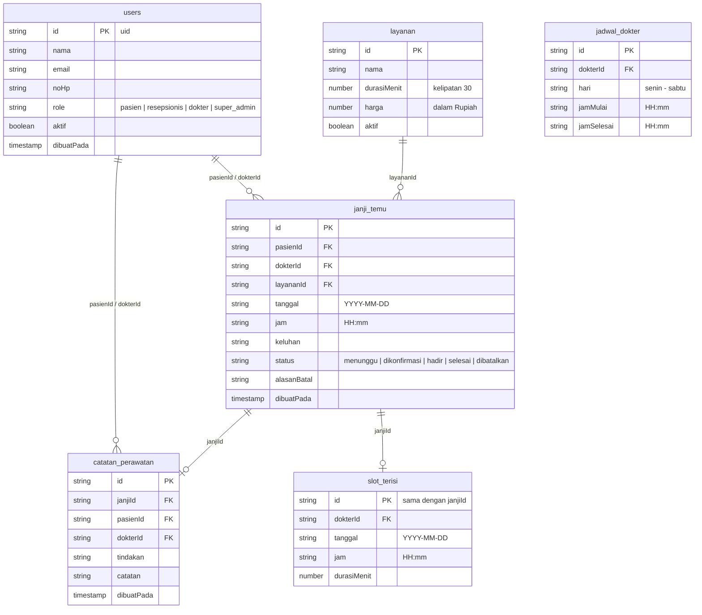

# Technical Design Specification: Portal Janji Senyum Rekah

## 1. Executive Summary & Context
Aplikasi web klinik gigi **Portal Janji Senyum Rekah (janji.senyumrekah.id)** dirancang untuk memodernisasi penjadwalan janji temu, manajemen pasien, dan pencatatan riwayat medis/perawatan secara digital. Sistem dibangun menggunakan **Next.js (App Router, JavaScript, Tailwind CSS)** dengan backend terkelola **Firebase Authentication** dan **Cloud Firestore**.

Sistem melayani **4 peran pengguna** (`pasien`, `resepsionis`, `dokter`, `super_admin`) dengan isolasi hak akses ketat, proteksi route guard client-side tanpa kedip, serta alur bisnis terintegrasi dari pemesanan hingga selesai pemeriksaan.

---

## 2. Core Architecture & Stack
- **Framework:** Next.js 14+ (App Router, JavaScript / JSX, Tailwind CSS).
- **Authentication:** Firebase Authentication (Email/Password & Google Sign-In Provider).
- **Database:** Cloud Firestore (6 koleksi: `users`, `layanan`, `jadwal_dokter`, `janji_temu`, `catatan_perawatan`, `slot_terisi`).
- **Icons & UI:** Lucide React icons, Tailwind CSS styling mengacu pada identitas Senyum Rekah (`#0E7490` Biru Rekah, `#F4F7F9` latar, `#FFFFFF` panel, `#1F2937` teks utama).
- **Fonts:** Inter typography dengan tabular figures (`tabular-nums`) untuk format jam, tanggal, dan rupiah.

---

## 3. Route Guard & Role-Based Access Control (RBAC)

### 3.1 Authentication & Profile State (`AuthContext`)
- `onAuthStateChanged` mendengarkan perubahan status login.
- Membaca dokumen `users/{uid}` dari Firestore secara realtime (`onSnapshot` atau `getDoc`).
- Jika pengguna login pertama kali (misal via Google), sistem otomatis membuat profil awal:
  ```json
  {
    "nama": user.displayName || "Pengguna Baru",
    "email": user.email,
    "noHp": "",
    "role": "pasien",
    "aktif": true,
    "dibuatPada": serverTimestamp()
  }
  ```
  *(Dokumen profil yang sudah ada tidak pernah ditimpa ulang)*.
- Tidak ada password atau kredensial sensitif yang disimpan di Firestore.

### 3.2 Route Guard Component (`<RouteGuard allowedRoles={[...]} />`)
1. **Keadaan Memuat (`loading`):** Menampilkan spinner/indikator memuat Senyum Rekah. Tidak mengarahkan (*redirect*) sebelum auth & peran selesai dibaca untuk mencegah kedipan layar (*flash of unauthenticated content*).
2. **Belum Masuk (`!user`):** Mengarahkan ke `/masuk?redirectUrl=[pathname]`.
3. **Akun Dinonaktifkan (`aktif === false`):** Menampilkan pesan *"Akun Anda dinonaktifkan. Hubungi klinik."* dan tombol keluar.
4. **Pengecekan Peran (`role`):**
   - Jika role termasuk dalam `allowedRoles` atau role adalah `super_admin` &rarr; Izinkan render konten halaman.
   - Jika tidak berhak &rarr; Tampilkan halaman **Akses Ditolak (403)** dengan penjelasan yang bersahabat dan tombol kembali.
5. **Pengalihan Otomatis Setelah Masuk:**
   - `pasien` &rarr; `/beranda`
   - `resepsionis` &rarr; `/resepsionis`
   - `dokter` &rarr; `/dokter`
   - `super_admin` &rarr; `/admin`

---

## 4. Firestore Data Models & Schema (PRD 7.1)



---

## 5. End-to-End Core Workflow & Logic

### 5.1 Alur Pembuatan Janji Pasien (`/janji/baru`)
1. Membaca daftar layanan aktif dari `layanan` (dimana `aktif == true`).
2. Membaca daftar dokter aktif (`role == 'dokter' && aktif == true`).
3. Saat pasien memilih Dokter dan Tanggal:
   - Hitung hari (Senin - Sabtu). Ambil jadwal praktik dokter di `jadwal_dokter` untuk hari tersebut.
   - Buat interval slot per 30 menit antara `jamMulai` dan `jamSelesai`.
   - Query `slot_terisi` untuk dokter dan tanggal tersebut. Slot yang overlap/bentrok dihilangkan dari opsi pilihan.
4. Pasien mengisi keluhan dan submit form:
   - Simpan dokumen `janji_temu` dengan status `"menunggu"`.
   - Simpan dokumen `slot_terisi` dengan ID dokumen yang sama dengan ID `janji_temu`.

### 5.2 Alur Resepsionis (`/resepsionis/janji/[id]`)
- **Konfirmasi:** Mengubah status janji menjadi `"dikonfirmasi"`.
- **Jadwal Ulang:** Memilih slot baru, memperbarui `janji_temu` dan `slot_terisi`.
- **Batalkan:** Mengisi alasan pembatalan, ubah status menjadi `"dibatalkan"`, dan hapus dokumen di `slot_terisi`.
- **Tandai Hadir:** Saat pasien tiba di klinik pada hari-H, status diubah menjadi `"hadir"`.

### 5.3 Alur Dokter (`/dokter/janji/[id]`)
- Janji dokter berstatus `"hadir"` tampil dengan tanda *"Siap diperiksa"*.
- Dokter membuka form pemeriksaan, mengisi `tindakan` dan `catatan`.
- Klik "Tandai Selesai" &rarr; Buat dokumen `catatan_perawatan`, ubah status janji di `janji_temu` menjadi `"selesai"`.

### 5.4 Alur Riwayat Pasien (`/riwayat`)
- Menampilkan semua janji temu milik pasien tersebut yang berstatus `"selesai"`, dilengkapi tindakan medis dan catatan dokter dari `catatan_perawatan`.

---

## 6. Implementation Stages & Verification
- **Tahap 1:** Dokumentasi `docs/rancangan.md` (Matriks akses, Peta route, Jawaban 4 keputusan).
- **Tahap 2:** Setup Next.js, Tailwind, `docs/PRD.md`, Firebase SDK connection (`lib/firebase.js`), dan seed data (`scripts/seed.js` / Admin Seeder).
- **Tahap 3:** Auth & User Document (Login Email & Google, `users/{uid}`, Header Navbar profil).
- **Tahap 4:** Super Admin & Kelola Pengguna (`/admin/pengguna`, ubah peran & nonaktifkan).
- **Tahap 5:** Route Guard & Redirects (4 kelompok peran, proteksi 403, bebas kedipan).
- **Tahap 6:** Pengujian 4 Akun & Tabel Uji `docs/uji.md` (>= 16 baris skenario + uji reload).
- **Tahap 7:** Alur Inti End-to-End dengan data Firestore riil.
- **Tahap 8:** Netlify Deployment ditunda (*deferred*) sesuai instruksi pengguna.
